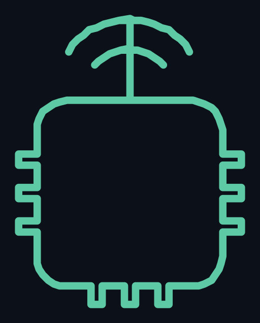
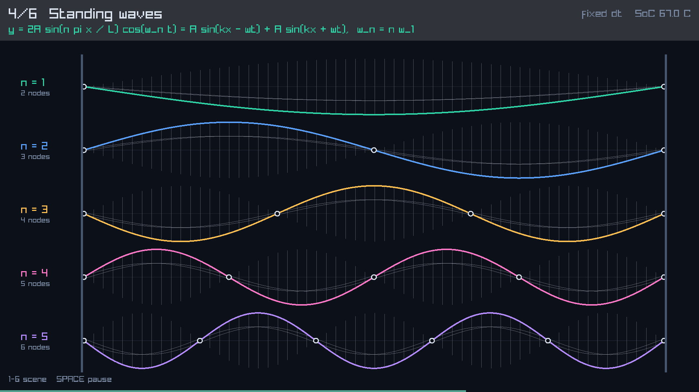
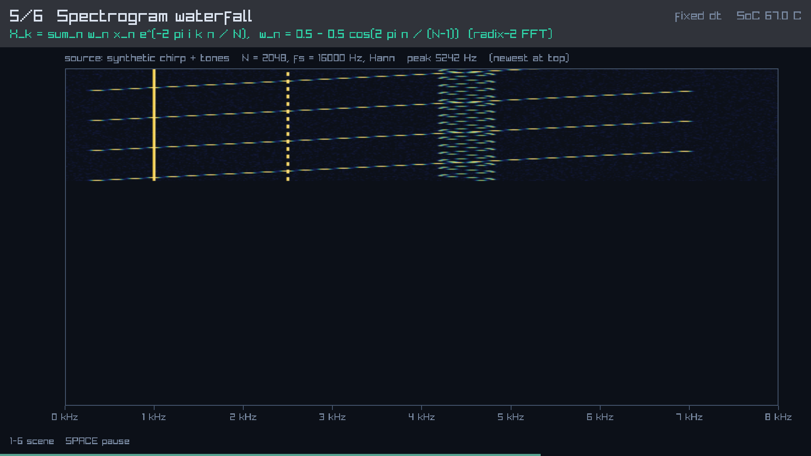
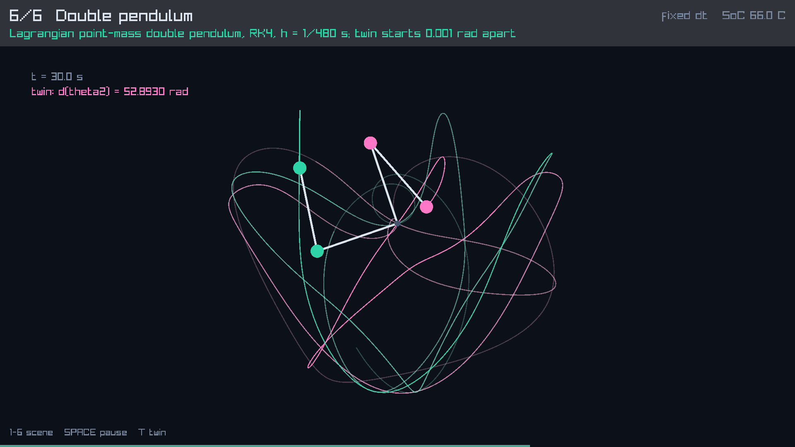
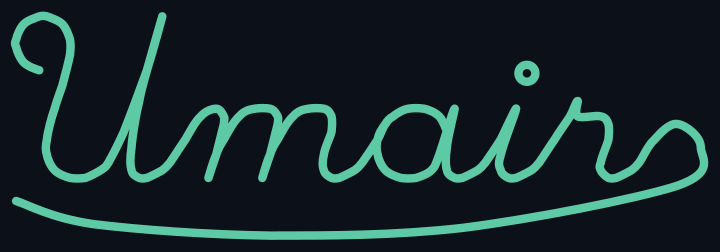

# hdmi-wave-demo

An attract-mode demo for an HDMI screen: six short maths and physics scenes,
45 s each, drawn with [raylib](https://www.raylib.com/) 5.5 in C. It is written
for a Raspberry Pi 5 driving a 1080p display. The same code builds for a
Wayland compositor (Weston), for bare DRM/KMS with no compositor, and as a
windowed program on an x86 Linux PC.

Repository: https://github.com/umair-as/hdmi-wave-demo (not created yet).

## Scenes

| # | Scene | Formula shown |
|---|-------|---------------|
| 1 | Spring and phasor | `x(t) = A cos(wt)`: the phasor's vertical projection moves the mass, and the graph traces x(t) |
| 2 | Square wave from odd harmonics | `f(t) = (4/pi) * sum_{k=1,3,..15} sin(k w t) / k`: one harmonic is added every cycle/8 s, with spectrum bars and a matching 110 Hz tone |
| 3 | Fourier epicycles | `c_k = (1/N) sum_n z_n e^(-2 pi i k n / N)`, N = 256: circles are sorted by radius and added one by one |
| 4 | Standing waves | `y = 2A sin(n pi x / L) cos(w_n t)`, n = 1..5, drawn with the two travelling waves that sum to it and its nodes marked |
| 5 | Spectrogram waterfall | Hann-windowed radix-2 FFT of a synthetic chirp plus tones, or of a USB microphone when one is present |
| 6 | Double pendulum | Lagrangian point-mass equations integrated with RK4 (h = 1/480 s), plus an optional twin started 0.001 rad away |

An overlay shows the scene name, its formula, the FPS and the SoC temperature.
The temperature comes from the first `/sys/class/thermal/thermal_zone*` whose
`type` contains `cpu` or `soc`, else from zone0, and reads `n/a` when no zone is
readable.

Screenshots from `--headless-shot` (1920x1080, 120 frames at a fixed 0.25 s
step, so each one shows the scene 30 s in):

| | |
|---|---|
|  |  |
|  |  |
|  |  |

### Scene 3: the project mark and signature

By default scene 3 draws the project's own SVGs. The mark is on top and the
signature is below it, both upright and scaled to fit 1080p with margins:

| Run | Element | Shape | N (samples = circles) |
|---|---|---|---|
| 1 | `#logo-mark` | closed path | 256 |
| 2 | `#signature` | open stroke, traced out and back | 1024 |
| 3 | `#idot` | circle, a short second pass on the signature | 64 |

 

*(Previews rendered with librsvg.)*

The signature gets N = 1024, because at 256 the lowercase letters come out
rounded off. Its out-and-back length is about 756 units, so 1024 samples are
about 0.74 units apart. N is one field per run, `default_runs[]` in
`src/scene_epicycles.c`. The runs play one after another, and each run's time
grows with sqrt(N): about 12.9 s, 25.7 s and 6.4 s of the 45 s scene. To keep
the frame cheap with 1024 terms, circles under 0.5 px radius are not drawn,
segment counts follow the radius, and the circles and thin arms are submitted
as consecutive line batches (one draw call per batch). The partial-sum curve
is updated incrementally from a per-run twiddle table, never recomputed.

Asset lookup: `${datadir}/hdmi-wave-demo/assets/` when installed. A binary run
from its build tree reads the repository's `assets/` instead (CMake option
`HWD_DEV_ASSETS`, default ON; the Yocto recipe turns it off so no build-host
path is compiled in). If neither is readable, the scene falls back to a
built-in heart. `--svg` replaces the defaults.

### SVG loader

`--svg FILE` loads every `<path>` and `<circle>` of FILE in document order, and
`--svg FILE#ID` loads one element. Each file gets its own band, drawn below the
previous one. Shapes from one file share that band's frame, so the i-dot stays
on its stroke.

- Path commands: absolute `M`, `L`, `C` and `Z`, with one subpath. Cubics are
  flattened in 64 steps.
- Transforms: `scale()`, `translate()` and `matrix()` on enclosing `<g>`
  elements and on the element itself are applied. The assets' `<g
  transform="scale(1,-1)">` y-flip therefore comes out upright.
- Shape defaults under `--svg`: a closed path (`Z`) gets 256 points. An open
  stroke is traced forward and then back, so it closes without a jump and turns
  around at the stroke's end; it gets 1024 points. A `<circle>` is a 64-point
  loop.

## Build

Requirements: CMake 3.20 or newer, a C11 compiler, and network access for the
first configure. raylib 5.5 is fetched as the release tarball and pinned by
SHA256 (`aea98ecf…e258e`). A system raylib 5.5 is used instead when
`find_package` finds one, but microphone capture then turns off, because it
relies on the miniaudio copy inside the bundled raylib. raylib is built
static, without examples, models or file loaders except PNG (needed for the
screenshots), and with the audio module (`raudio`).

CMake options:

| Option | Values | Meaning |
|---|---|---|
| `HWD_PLATFORM` | `wayland` (default), `drm` | Display path |
| `HWD_DESKTOP_BACKEND` | `GLFW` (default), `SDL` | Windowing library for the wayland path |
| `HWD_GLFW_X11` | `ON` (default) / `OFF` | GLFW: also build its X11 backend |
| `HWD_GLES` | `OFF` (default) / `ON` | wayland path: GLES 3.0 instead of desktop GL 3.3 |
| `FETCHCONTENT_SOURCE_DIR_RAYLIB` | path | Use an unpacked raylib 5.5 and skip the download (offline builds, Yocto) |

How the display paths map to raylib platforms:

- **wayland, GLFW backend**: raylib `PLATFORM_DESKTOP` with its bundled GLFW,
  built with Wayland support, plus X11 when `HWD_GLFW_X11=ON`. The Yocto recipe
  uses this backend, Wayland-only, with GLES 3.0. It needs the
  `wayland-client`, `wayland-scanner` and `xkbcommon` development files, and
  for X11 the Xrandr, Xinerama, Xcursor and Xi headers.
- **wayland, SDL backend**: raylib `PLATFORM_DESKTOP_SDL`. SDL2 chooses Wayland
  or X11 at run time, so one x86 binary opens a native window on either kind of
  session. Use this on a PC that has the SDL2 headers but not the Wayland/X11
  headers GLFW needs. The development host this was written on is in that
  state (`sdl2-compat-devel` installed, no `wayland-devel` or `libxkbcommon-devel`).
- **drm**: raylib `PLATFORM_DRM` (GBM + EGL + libdrm, GLES 2.0). It runs
  fullscreen on the first connected output, with no compositor.

No custom shaders are used: everything is raylib shapes, lines and one
streamed texture. That is why there is no GLSL to maintain for both GL and
GLES.

```sh
# x86 PC (what was built and tested here): SDL backend, desktop GL 3.3
cmake -S . -B build-host -G Ninja -DHWD_DESKTOP_BACKEND=SDL
cmake --build build-host -j2

# x86 PC with wayland-devel, libxkbcommon-devel and the X11 headers: GLFW, Wayland + X11
cmake -S . -B build-glfw -G Ninja
cmake --build build-glfw

# Raspberry Pi 5 under Weston (normally through the Yocto recipe)
cmake -S . -B build-pi -DHWD_PLATFORM=wayland -DHWD_GLFW_X11=OFF -DHWD_GLES=ON

# Raspberry Pi 5 on DRM/KMS, no compositor
cmake -S . -B build-drm -DHWD_PLATFORM=drm
```

## Run

```
hdmi-wave-demo [options]
  --scene N           start at scene N (1-6)
  --cycle SECONDS     attract-mode time per scene (default 45)
  --fullscreen        fullscreen (default on the drm build)
  --windowed WxH      window size (default 1280x720)
  --mute              no audio output
  --svg FILE[#ID]     shapes for the epicycle scene (repeatable; each file in its own band, below the previous)
  --seed N            seed for the random parts (default 12345)
  --headless-shot DIR render 120 frames per scene at 1920x1080, write DIR/sceneN.png, exit 0
  --render WxH        draw at a fixed WxH offscreen and scale it to the window
  --duration SECONDS  quit after SECONDS (tests, benchmarks)
  --stats             print frame-time statistics (every second, and per scene on change/exit)
```

Keys: `1`-`6` jump to a scene, `SPACE` pauses (the audio fades out), `LEFT`
and `RIGHT` step through the scenes, `T` toggles the twin pendulum in scene 6,
and `ESC` quits. SIGTERM and SIGINT exit cleanly with status 0.

Audio: scene 2 plays the partial sum it draws, at a 110 Hz fundamental and
about -18 dBFS peak. The synthesis callback runs on a raylib `AudioStream`.
The master gain fades over 0.35 s on scene changes and on pause, and each new
harmonic fades in over 0.25 s, so nothing clicks. With `--mute` the program
never opens an audio device.

Microphone: when scene 5 starts, it lists capture devices through miniaudio and
opens the first one whose name contains "USB". If none is found, it uses the
synthetic signal. Either way it logs the choice, for example
`spectrogram source: synthetic (no USB capture device)`. `--headless-shot`
always uses the synthetic signal.

## Yocto

This repository is a plain CMake project. The Yocto recipe, the systemd unit
and the kiosk wrapper live in the rpi5-iot-gateway layer
(`meta-iot-gateway/recipes-graphics/hdmi-wave-demo/`), which pins a commit of
this repository and installs the demo as the desktop image's boot default on
HDMI.

## Testing

All commands were run on the x86 development host (Fedora, Wayland session)
under `nice -n 19` with at most `-j2`, while a Yocto build was using the
machine (load average about 26-29 on 8 cores).

```sh
nice -n 19 cmake -S . -B build-host -G Ninja -DHWD_DESKTOP_BACKEND=SDL
nice -n 19 cmake --build build-host -j2

# unit tests: FFT vs naive DFT (n = 8..4096, random + impulse/DC/single-bin
# sinusoid/cosine, tolerance 1e-9 relative) and the SVG loader on both assets
# (test_svgpath assets/logo-mark.svg assets/signature.svg)
(cd build-host && nice -n 19 ctest --output-on-failure)

# headless screenshots + content check
nice -n 19 ./build-host/hdmi-wave-demo --headless-shot docs/shots
python3 tools/check_shots.py docs/shots

# frame times at a 1920x1080 render size, one scene per run, 5 s each
for n in 1 2 3 4 5 6; do
  SDL_VIDEODRIVER=wayland nice -n 19 timeout 10 ./build-host/hdmi-wave-demo \
    --windowed 1280x720 --render 1920x1080 --scene $n --mute --stats --duration 5
done

# windowed run on the Wayland session, then SIGTERM (also repeated with SDL_VIDEODRIVER=x11)
SDL_VIDEODRIVER=wayland ./build-host/hdmi-wave-demo --windowed 1280x720 --mute &
sleep 3; kill -TERM $!; wait $!; echo exit=$?
```

`test_svgpath` checks each asset after the group transform:

| Element | Checks | Measured |
|---|---|---|
| `#logo-mark` | one `<path>` in the file, one closed subpath, 256 samples, max step <= 1.5x mean including last to first, y flipped | 137 segments, length 88.04, max/mean **1.036** |
| `#signature` | one open subpath traced out and back, closes on its start, turnaround == stroke end (raw (2, -12), transformed (2, 12)), same jump criterion on 256 samples, and on the 1024 samples scene 3 traces | 113 segments, length 755.94, max/mean **1.045** (256), **1.007** (1024) |
| `#idot` | `<circle>` with r = 1.1 at (68.4, 4.6) before the transform, at y = -4.6 after it, 64 samples | max/mean **1.000** |

`tools/check_path.py` predates these assets. It expects a single closed path,
so it does not apply to the open signature stroke.

Host frame times (CPU work = update + draw + GL submit, from `--stats`, in ms):

| Scene | 1 | 2 | 3 | 4 | 5 | 6 |
|---|---|---|---|---|---|---|
| CPU mean | 0.95 | 1.10 | 1.51 | 2.76 | 2.33 | 0.85 |
| CPU p99 | 5.08 | 5.06 | 4.50 | 6.04 | 6.52 | 5.22 |
| frame interval mean | 2.38 | 2.30 | 2.77 | 3.73 | 3.47 | 2.11 |

Scene 3 above covers its first 5 s, which is the mark. The expensive part is
the signature with all 1024 circles. That run was measured on its own, with
the build-up compressed into 9.5 s:

```sh
SDL_VIDEODRIVER=wayland nice -n 19 timeout 15 ./build-host/hdmi-wave-demo --windowed 1280x720 \
  --render 1920x1080 --scene 3 --mute --stats --cycle 9.5 --duration 9.5 \
  --svg 'assets/signature.svg#signature'
```

With all 1024 terms present (t >= 8.1 s), CPU time was 2.6 ms mean and
14-16 ms max per frame. During the final growth burst it was 3.4 ms mean and
21 ms max. That burst is four times steeper than in the default 45 s schedule.

On this session the swap was not vsync-throttled, so the interval is the
uncapped throughput. The machine was heavily loaded while these were measured.

**Not verified:** 60 fps at 1080p on the Raspberry Pi 5 under Weston, the
GLFW backend (its headers are not on the host), the DRM path (no libdrm/gbm
headers on the host, so it has not even been compiled), audible output (the
audio device was opened and the stream started, but scene 2 was not played
through speakers), microphone capture (no USB microphone on the host), and the
Yocto recipe (never parsed or built). The GLES 3.0 code path was built and
run on the host through SDL with `-DHWD_GLES=ON`. Its headless screenshots
passed `check_shots.py` and matched the GL 3.3 ones except for the temperature
text.

## Layout

```
src/main.c                CLI, main loop, overlay, headless screenshots, frame stats
src/scene.h, scenes.c     scene interface and the scene table (attract-mode order)
src/scene_*.c             one file per scene
src/fft.c                 radix-2 FFT, naive DFT, Hann window
src/svgpath.c             SVG loader (M/L/C/Z paths, circles, g transforms) + arc-length resampling
src/audio.c, mic.c        AudioStream synthesis; miniaudio USB capture
src/thermal.c, draw.c     SoC temperature; drawing helpers and palette
tests/                    ctest programs
tools/check_shots.py      screenshot content check
```

To add a scene, write `src/scene_<name>.c` that exports a `Scene`, then add it
to `src/scenes.c` and to `HWD_SCENES` in `CMakeLists.txt`.
