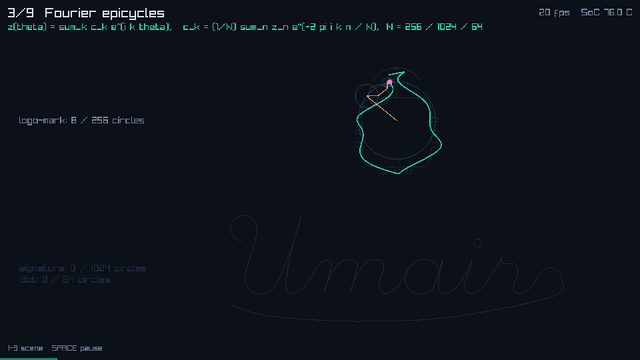
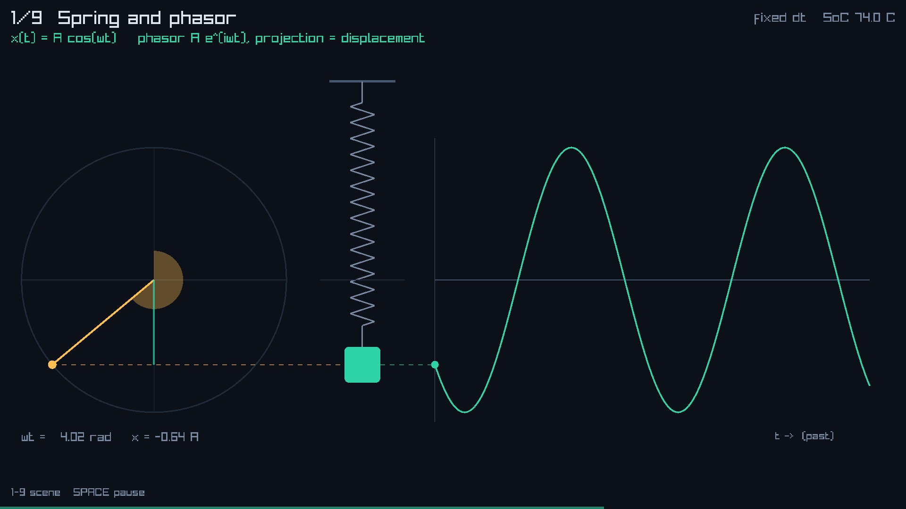
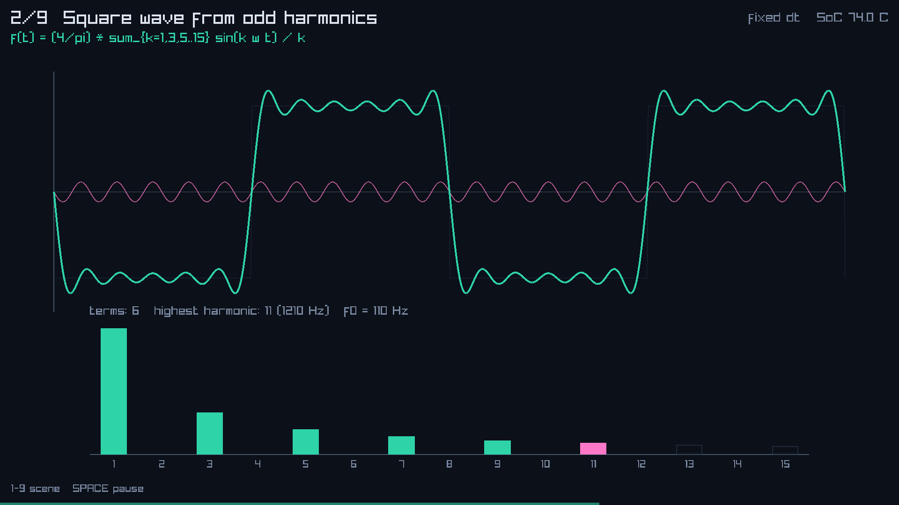
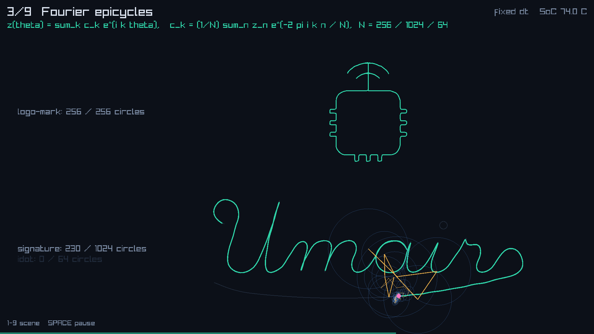
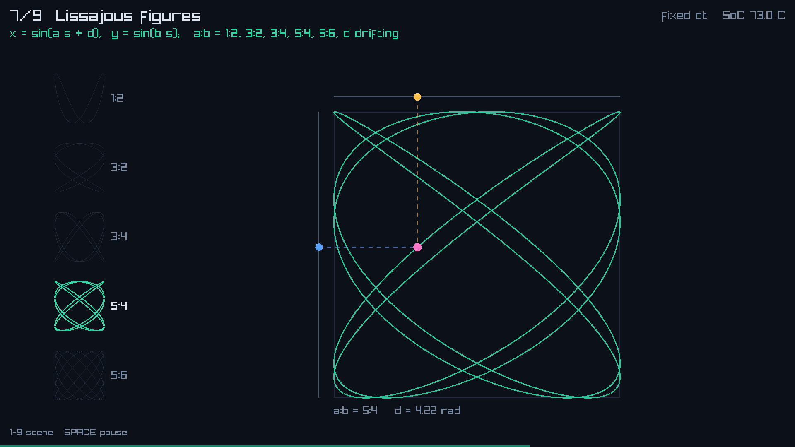
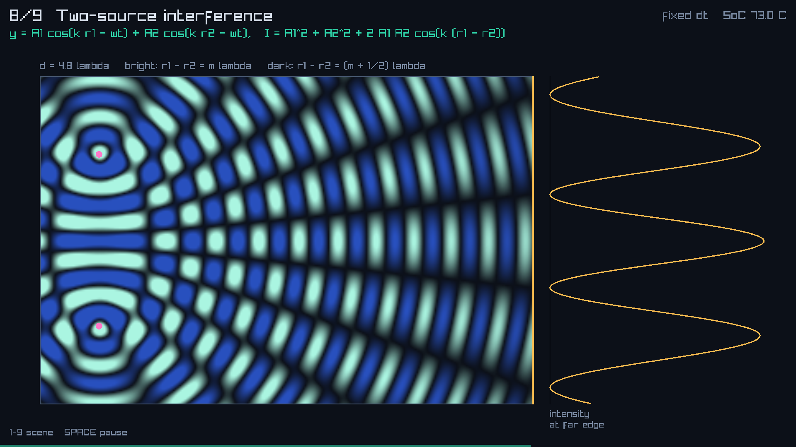
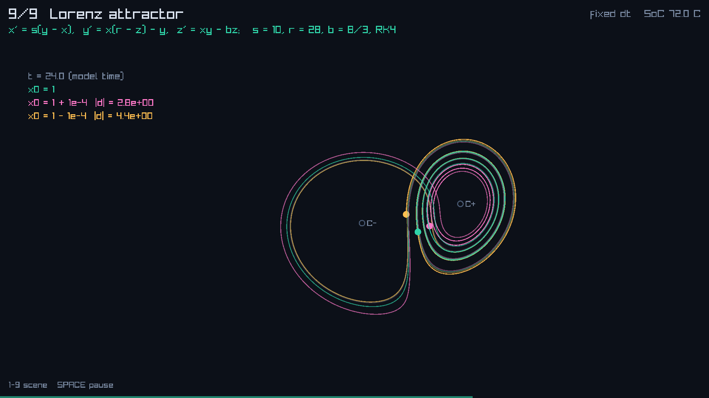
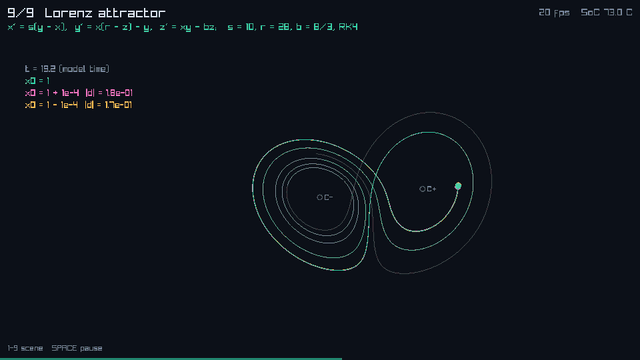

# hdmi-wave-demo

An attract-mode demo for an HDMI screen: nine short maths and physics scenes
that cycle every 45 seconds. It is written in C with
[raylib](https://www.raylib.com/) 5.5 for a Raspberry Pi 5 on a 1080p display,
and the same code runs under Wayland (Weston), directly on DRM/KMS without a
compositor, or in a window on a Linux PC.



## Scenes

| # | Scene | What it shows |
|---|-------|---------------|
| 1 | Spring and phasor | A mass on a spring driven by a rotating phasor; the graph traces `x(t) = A cos(wt)` |
| 2 | Square wave from odd harmonics | Harmonics 1, 3, ..., 15 added one at a time, with a spectrum and a matching 110 Hz tone |
| 3 | Fourier epicycles | The project's logo and signature redrawn by up to 1024 rotating circles, added largest first |
| 4 | Standing waves | Modes n = 1..5 on a fixed string, each the sum of two travelling waves, with nodes marked |
| 5 | Spectrogram waterfall | A Hann-windowed FFT of a synthetic chirp, or of a USB microphone if one is plugged in |
| 6 | Double pendulum | RK4 integration with an optional twin started 0.001 rad away (key `T`) |
| 7 | Lissajous figures | Two perpendicular oscillators at ratios 1:2 to 5:6, with the pen's projections on rails |
| 8 | Two-source interference | A ripple tank whose sources move apart from 1 to 6 wavelengths, with the intensity at the far edge |
| 9 | Lorenz attractor | Three trajectories started 1e-5 apart that ride together and then split onto different wings |

Each scene shows its formula. The top bar also shows the frame rate and the
SoC temperature.

| | | |
|---|---|---|
|  |  |  |
|  |  |  |
|  |  |  |

*Rendered with `--headless-shot`: 1920x1080, 30 s into each scene.*

Scene 9, where three Lorenz trajectories started 1e-4 apart split onto
different wings:



## Build

You need CMake 3.20+, a C11 compiler and network access on the first
configure. raylib 5.5 is downloaded as its release tarball (pinned by SHA256)
and linked statically, with only the modules the demo uses.

```sh
# Linux PC, SDL2 backend: opens a window under Wayland or X11
cmake -S . -B build -G Ninja -DHWD_DESKTOP_BACKEND=SDL
cmake --build build

# Linux PC, bundled GLFW (needs the Wayland, xkbcommon and X11 dev headers)
cmake -S . -B build -G Ninja

# Raspberry Pi 5 under Weston: Wayland only, OpenGL ES 3.0
cmake -S . -B build -DHWD_GLFW_X11=OFF -DHWD_GLES=ON

# Raspberry Pi 5 on bare DRM/KMS, no compositor (GLES 2.0)
cmake -S . -B build -DHWD_PLATFORM=drm
```

| CMake option | Default | Meaning |
|---|---|---|
| `HWD_PLATFORM` | `wayland` | `wayland` (a normal window/fullscreen client) or `drm` (straight to KMS) |
| `HWD_DESKTOP_BACKEND` | `GLFW` | Windowing library for the wayland path: `GLFW` or `SDL` |
| `HWD_GLFW_X11` | `ON` | Also build GLFW's X11 backend |
| `HWD_GLES` | `OFF` | wayland path: OpenGL ES 3.0 instead of desktop GL 3.3 |
| `HWD_DEV_ASSETS` | `ON` | Let a binary in the build tree read `assets/` from the source tree |
| `FETCHCONTENT_SOURCE_DIR_RAYLIB` | unset | Build an already unpacked raylib 5.5 instead of downloading it |

If a system raylib 5.5 is found it is used instead, but microphone input is
then disabled, because it relies on the miniaudio copy inside the bundled
raylib. No custom shaders are used, so the same code runs on GL 3.3, GLES 3.0
and GLES 2.0.

## Run

```
hdmi-wave-demo [options]
  --scene N           start at scene N (1-9)
  --cycle SECONDS     time per scene (default 45)
  --fullscreen        fullscreen (default on the drm build)
  --windowed WxH      window size (default 1280x720)
  --mute              no audio output
  --svg FILE[#ID]     shapes for the epicycle scene (repeatable)
  --seed N            seed for the random parts (default 12345)
  --render WxH        draw at a fixed size offscreen and scale it to the window
  --headless-shot DIR write DIR/sceneN.png for every scene and exit
  --record DIR        write one scene as a PNG sequence (20 fps) and exit
  --start SECONDS     --record: scene time to start at
  --duration SECONDS  quit after SECONDS
  --stats             print frame-time statistics
```

| Key | Action |
|---|---|
| `1`-`9` | Jump to a scene |
| `LEFT` / `RIGHT` | Previous / next scene |
| `SPACE` | Pause (the audio fades out) |
| `T` | Scene 6: toggle the twin pendulum |
| `ESC` | Quit |

SIGTERM and SIGINT exit cleanly with status 0.

**Audio.** Scene 2 plays the partial sum it draws, at about -18 dBFS. Volume
changes fade, so scene changes and pauses do not click. With `--mute` no audio
device is opened.

**Microphone.** Scene 5 opens the first capture device whose name contains
"USB" and falls back to its synthetic signal otherwise. It logs which source it
picked.

**Temperature.** Read from the first `/sys/class/thermal/thermal_zone*` whose
type contains `cpu` or `soc` (else zone 0); shown as `n/a` if none is readable.

## Epicycle shapes

By default scene 3 draws `assets/logo-mark.svg` (a closed path, 256 circles)
and then `assets/signature.svg` (an open stroke traced out and back, 1024
circles, followed by the dot of the i, 64 circles). The installed copy in
`share/hdmi-wave-demo/assets/` is used; a build-tree binary uses the source
tree's copy. If neither can be read, it draws a heart.

`--svg FILE` replaces the defaults with every `<path>` and `<circle>` in FILE,
and `--svg FILE#ID` with one element. Each file gets its own band on screen.
The loader is deliberately small:

- paths with absolute `M`, `L`, `C` and `Z` commands and a single subpath;
- `<circle cx cy r>`;
- `scale()`, `translate()` and `matrix()` transforms on the element and its
  enclosing `<g>` elements.

A closed path gets 256 samples, an open stroke 1024 and a circle 64.

## Packaging

This repository is a plain CMake project; `cmake --install` installs the
binary and the SVG assets only. The Yocto recipe, the systemd unit and the
Weston kiosk wrapper live in the
[rpi5-iot-gateway](https://github.com/umair-as/rpi5-iot-gateway) layer under
`meta-iot-gateway/recipes-graphics/hdmi-wave-demo/`, which builds a pinned
commit of this repository.

## Development

```sh
cmake -S . -B build -G Ninja -DHWD_DESKTOP_BACKEND=SDL
cmake --build build
(cd build && ctest --output-on-failure)      # FFT and SVG loader tests

./build/hdmi-wave-demo --headless-shot docs/shots
python3 tools/check_shots.py docs/shots      # every shot has real content
tools/make_gifs.sh                           # docs/gifs/*.gif (needs ffmpeg)

./build/hdmi-wave-demo --render 1920x1080 --scene 8 --mute --stats --duration 10
```

- `test_fft` compares the FFT with a naive DFT for n = 8 to 4096.
- `test_svgpath` loads both assets and checks that the resampled outlines have
  no jumps, that the y-flip transform is applied and that the signature turns
  around at its end.
- `tools/check_path.py` checks a single closed SVG path and can render a
  preview.

```
CMakeLists.txt          project, options, subdirectories
cmake/                  options, raylib (fetched or system), warning flags
src/main.c              command line, main loop, overlay, headless rendering
src/core/               shared settings and PRNG, drawing helpers and palette
src/devices/            audio output, USB microphone, SoC temperature
src/maths/              FFT and SVG loader: library hwd_maths, no raylib
src/scenes/             scene interface, attract-mode order, one file per scene
tests/                  unit tests against hwd_maths
tools/                  screenshot check, SVG path check, GIF script
assets/, docs/          SVGs for scene 3, screenshots and GIFs
```

To add a scene, write `src/scenes/<name>.c` exporting a `Scene` (see
`src/scenes/scene.h`), add it to the table in `src/scenes/scenes.c` and to
the executable's sources in `src/CMakeLists.txt`. `BUILD_TESTING=OFF` skips
the tests (distro builds).

### Status

Built and run on an x86 PC (SDL backend, GL 3.3 and GLES 3.0). Not yet
verified: frame rate on the Raspberry Pi 5, the GLFW and DRM builds, audible
output through speakers, and microphone capture.

## License

MIT. raylib, which is linked into the binary, is under the zlib license.
